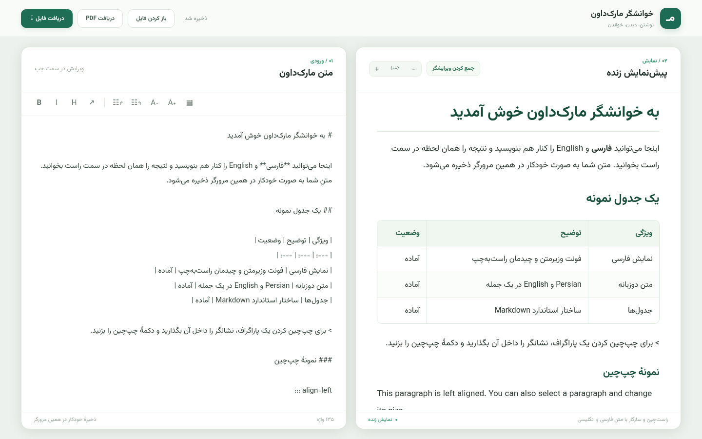

# خوانشگر مارک‌داون فارسی

ویرایشگر سبک Markdown برای لینوکس با پیش‌نمایش زندهٔ راست‌به‌چپ، فونت وزیرمتن و پشتیبانی از متن فارسی و انگلیسی. برنامه به صورت محلی اجرا می‌شود و صفحه را در مرورگر پیش‌فرض باز می‌کند.



## امکانات

- ویرایش در سمت چپ و پیش‌نمایش زنده در سمت راست، همراه با حالت تمرکز تمام‌عرض
- جدول‌های Markdown، کد، پیوند، فهرست و نقل‌قول
- راست‌چین/چپ‌چین و تغییر اندازهٔ پاراگراف انتخاب‌شده؛ بزرگ‌نمایی کل پیش‌نمایش
- باز کردن و دانلود فایل `.md` و ذخیرهٔ خودکار متن در مرورگر
- خروجی PDF از طریق چاپ مرورگر با فونت و چیدمان پیش‌نمایش
- اجرای محلی روی `127.0.0.1`؛ متن به سرور خارجی ارسال نمی‌شود

## نصب در اوبونتو

فایل `persian-md-reader_0.1.0_all.deb` را از بخش Releases دریافت کنید، یا آن را با دستورهای بخش «ساخت بسته» بسازید. سپس در پوشهٔ فایل:

```bash
sudo apt install ./persian-md-reader_0.1.0_all.deb
```

برنامه را از فهرست برنامه‌ها با نام «خوانشگر مارک‌داون فارسی» یا با دستور `persian-md-reader` باز کنید. راه‌انداز، سرویس محلی کاربر را اجرا می‌کند و صفحه را در مرورگر پیش‌فرض باز می‌کند. پورت `8765` باید آزاد باشد.

برای اجرای خودکار سرویس هنگام ورود به حساب کاربری:

```bash
systemctl --user enable --now persian-md-reader.service
```

برای توقف یا غیرفعال‌سازی آن:

```bash
systemctl --user disable --now persian-md-reader.service
```

برای حذف بسته، ابتدا `systemctl --user disable --now persian-md-reader.service` و سپس `sudo apt remove persian-md-reader` را اجرا کنید.

## اجرای مستقیم از کد

```bash
python3 -m venv .venv
.venv/bin/pip install -r requirements.txt
.venv/bin/python app.py
```

سپس [http://127.0.0.1:8765](http://127.0.0.1:8765) را باز کنید. برای استفاده از پورت دیگر: `.venv/bin/python app.py --port 9000`.

## ویرایش و خروجی

نشانگر را داخل پاراگراف بگذارید یا بخشی از آن را انتخاب کنید؛ دکمه‌های چینش و اندازه، کل پاراگراف را قالب‌بندی می‌کنند. قالب‌بندی در متن به شکل بلوک‌های `::: align-left`، `::: align-right`، `::: size-small` و `::: size-large` ذخیره می‌شود. جدول‌ها از ساختار معمول Markdown استفاده می‌کنند.

«جمع کردن ویرایشگر» پیش‌نمایش را تمام‌عرض می‌کند و این انتخاب در مرورگر حفظ می‌شود. برای PDF، «دریافت PDF» را بزنید و در پنجرهٔ چاپ، «ذخیره به‌صورت PDF» را انتخاب کنید. ظاهر، فونت و رنگ‌ها حفظ می‌شوند؛ عرض سطرها متناسب با صفحهٔ A4 تنظیم می‌شود.

## ساخت بستهٔ `.deb`

روی اوبونتو یا دبیان، با ابزار `dpkg-deb`:

```bash
bash packaging/build-deb.sh
```

خروجی در `dist/persian-md-reader_0.1.0_all.deb` قرار می‌گیرد. بسته به `python3`، `python3-markdown`، `xdg-utils` و `systemd` وابسته است و هنگام نصب، کتابخانه‌ای با `pip` دانلود نمی‌کند. فونت وزیرمتن با مجوز SIL Open Font License در بسته قرار دارد.

## انتشار در GitHub

پس از ساخت مخزن عمومی و افزودن آن به عنوان `origin`، شاخهٔ `main` را push کنید. GitHub Actions بسته را در هر push می‌سازد و به عنوان artifact در دسترس می‌گذارد. برای ساخت Release عمومی نسخهٔ فعلی:

```bash
git tag v0.1.0
git push origin v0.1.0
```

گردش‌کار GitHub فایل `.deb` را به Release همان برچسب پیوست می‌کند. شمارهٔ برچسب باید با فایل `VERSION` یکسان باشد.

## مجوز

کد و مستندات پروژه با [مجوز MIT](LICENSE) منتشر می‌شوند. فونت وزیرمتن مجوز جداگانهٔ [SIL Open Font License](public/OFL-Vazirmatn.txt) دارد و متن هر دو مجوز داخل بستهٔ `.deb` نیز قرار می‌گیرد.
